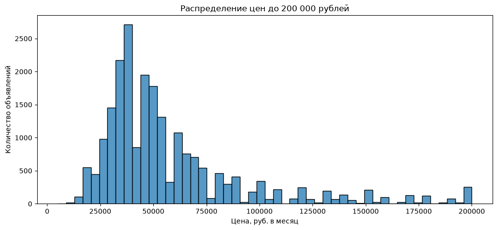
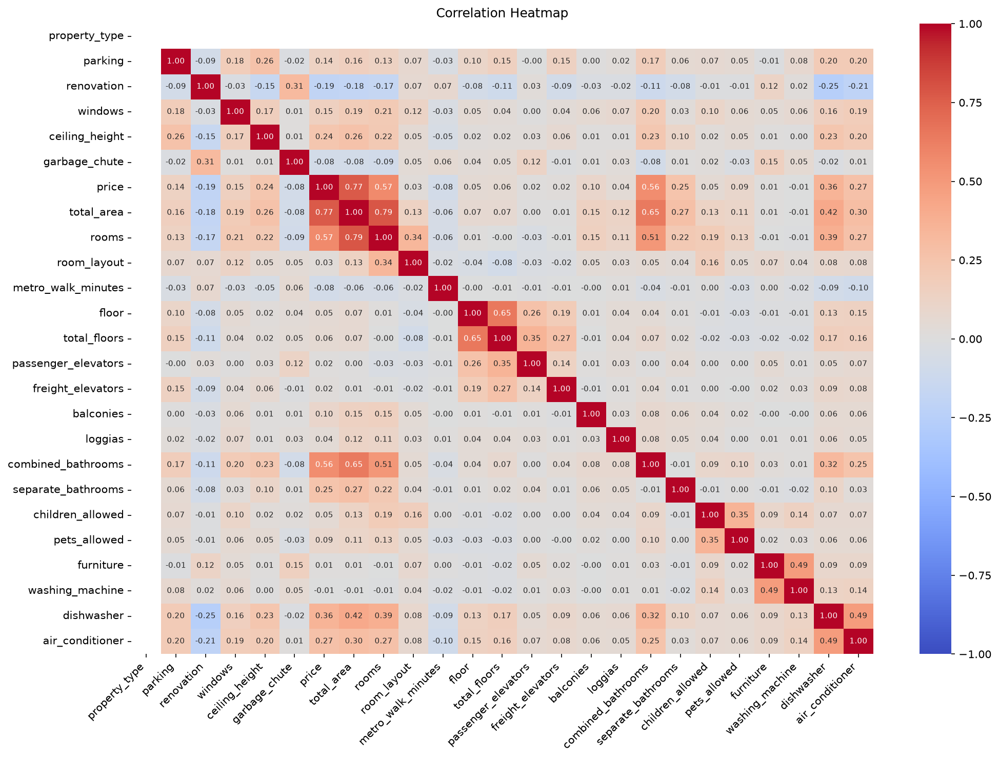

How Much Is The…? — Release 3

Цель проекта

Подготовить данные об аренде недвижимости для машинного обучения и проверить модель предсказания месячной стоимости аренды.

Подготовка данных

Оставлены объявления с ценами в рублях.

Признаки приведены к числовому формату.

Обработаны пропуски.

Проверены полные дубликаты и уникальность объявлений по id.

Подготовлен итоговый датасет data_3.csv.

Итоговый датасет: 23 344 объявления, 28 столбцов, пропусков нет, дубликатов id нет.

Основные выводы EDA

## Корреляционная матрица

Средняя цена аренды составляет около 82 967 рублей в месяц.

Медианная цена — 49 900 рублей в месяц.

Средняя площадь объекта — около 62,5 м².

Цена и площадь объектов сильно различаются, поэтому для анализа важно учитывать характеристики недвижимости.

Результаты моделирования

Были обучены и сравнены две модели:

Модель

MAPE

Linear Regression

39,35%

Random Forest

23,51%

Лучший результат показала модель Random Forest. MAPE составил 23,51%, что соответствует целевому значению менее 30%.

Файлы релиза

- `final_preparation.ipynb` — подготовка данных и эксперимент с моделями.
- `data_3.csv` — итоговый датасет для машинного обучения.
- `image.png` — график распределения цен аренды.